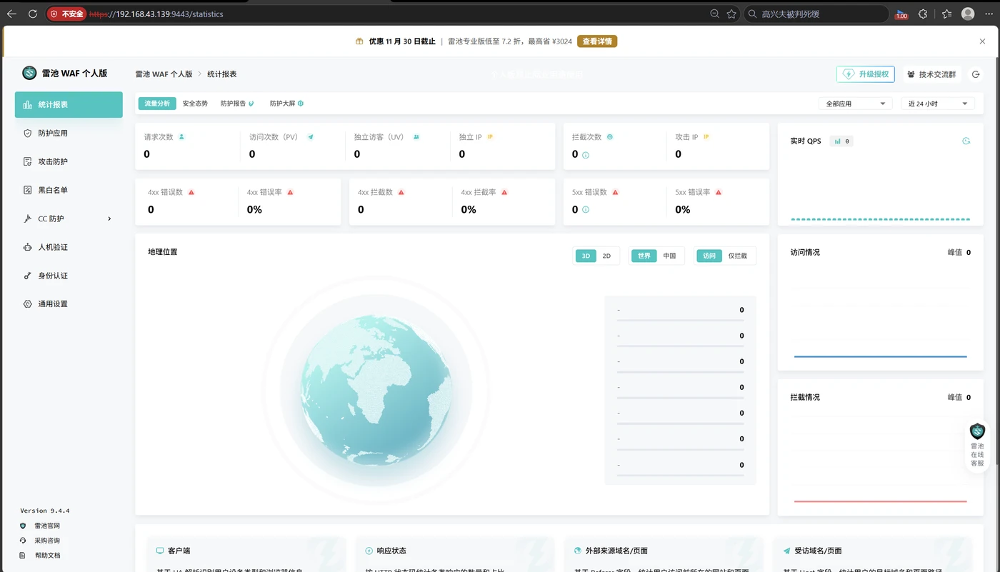
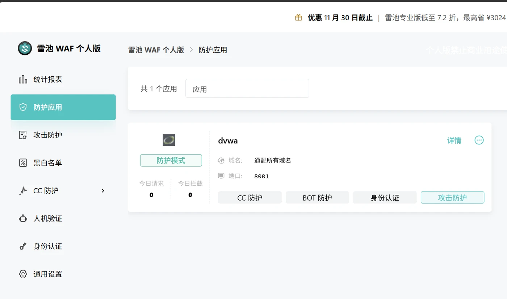

## 结构 

```
:8080  ──────────────────────>  DVWA        原靶场
:8081  ──> 雷池 SafeLine  ───>  DVWA        语义分析引擎
:8082  ──> ModSecurity CRS ──>  DVWA        正则规则引擎
:9443  ──> 雷池管理台
```

## 环境

| 项目  | 值                                        |
| --- | ---------------------------------------- |
| 虚拟化 | VMware Workstation                       |
| 系统  | Ubuntu 22.04.5 LTS Server                |
| 网络  | NAT（宿主机 192.168.43.1, 虚拟机 192.168.43.139） |

## 搭建DVWA


```bash
docker run -d --name dvwa -p 8080:80 --restart unless-stopped vulnerables/web-dvwa
```

浏览器打开 `http://192.168.43.139:8080`, 先进 `setup.php` 点一次 `Create / Reset Database`, 然后账号 `admin` / 密码 `password` 登录.

## 装雷池（SafeLine 个人版）

```bash
sudo bash -c "$(curl -fsSLk https://waf-ce.chaitin.cn/release/latest/setup.sh)"
```

装完浏览器访问 `https://192.168.43.139:9443`

在`防护应用`加上dvwa


## 装 ModSecurity

用 OWASP 官方镜像, 起个 compose 项目：

```yaml
services:
  waf:
    image: owasp/modsecurity-crs:nginx
    container_name: waf-modsec
    ports:
      - "8082:8080"
    environment:
      BACKEND: "http://192.168.43.139:8080"
      PARANOIA: "1"
      BLOCKING_PARANOIA: "1"
    restart: unless-stopped
```

```bash
cd ~/waf-modsec && sudo docker compose up -d
```

`PARANOIA` 是 CRS 的严格程度, 1 最宽松、4 最严（误报也最多）, 改完 `docker compose restart` 生效.

## 端口一览

| 端口 | 服务 | 容器 |
|---|---|---|
| 8080 | DVWA 直连 | `dvwa` |
| 8081 | 雷池入口 | `safeline-tengine` |
| 8082 | ModSecurity 入口 | `waf-modsec` |
| 9443 | 雷池管理台 | `safeline-mgt` |

## 两套 WAF 的区别

### 雷池：语义分析
雷池的做法是先理解 payload, 再判断意图.它把输入当成一段代码去解析, 还原出"这段内容如果真的执行了会做什么", 然后评估危险程度.
### ModSecurity + OWASP CRS：正则匹配
正则匹配的做法则是如果输入字符串中出现了已知攻击的特征片段, 就判定为恶意. 

## 其他

**挂起虚拟机后所有端口超时.** 
```bash
sudo systemctl restart docker
```
